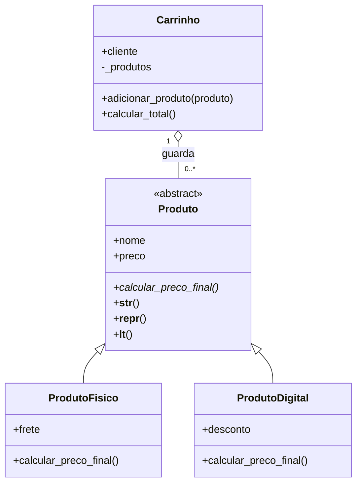

# Sistema de Loja com Programação Orientada a Objetos

**Disciplina:** Desenvolvimento em Python  
**Atividade:** Semana 06 - Desafio Sprint 6

## 1. Sobre o projeto

Este projeto simula uma loja que trabalha com produtos físicos e digitais. Cada produto tem nome e preço, mas o cálculo do valor final muda conforme seu tipo.

- **Produto físico:** preço original + frete.
- **Produto digital:** preço original - desconto percentual.
- **Carrinho:** guarda os produtos escolhidos e soma os preços finais.

Escolhi esse exemplo porque ele continua o tema de produtos trabalhado anteriormente e é parecido com o exercício de polimorfismo da Aula 06.

## 2. Arquivos

```text
sprint_06/
├── sistema_loja.py     # Classes e demonstração com 10 produtos
├── testes.py           # Testes simples dos cálculos e validações
├── exemplo_saida.txt   # Resultado de uma execução do programa
└── README.md           # Documentação da atividade
```

O projeto usa apenas bibliotecas que já acompanham o Python: `abc` e `math`.

## 3. Diagrama de classes



## 4. Por que essas classes?

**`Produto`** é a classe mãe e abstrata. Ela reúne o nome, o preço e as validações que todos os produtos precisam ter. O método `calcular_preco_final()` é abstrato, pois cada tipo de produto deve definir como calcular seu valor.

**`ProdutoFisico`** é um Produto. Por isso, usa herança e `super().__init__()` para aproveitar nome e preço. Acrescenta o frete no cálculo do preço final.

**`ProdutoDigital`** também é um Produto. Reaproveita a classe mãe, mas aplica um desconto percentual no valor final.

**`Carrinho`** não é um Produto: ele tem produtos. Por isso, utilizei uma relação de agregação, armazenando os objetos da classe Produto em uma lista interna. Cada produto pode existir independentemente do carrinho.

## 5. Conceitos de POO utilizados

| Conceito | Onde aparece |
|---|---|
| Classes e objetos | `Produto`, `ProdutoFisico`, `ProdutoDigital`, `Carrinho` e seus objetos |
| Classe abstrata | `Produto(ABC)` e `@abstractmethod` |
| Construtor | `__init__` nas quatro classes |
| Representação amigável | `__str__` nas quatro classes |
| Representação técnica | `__repr__` nas quatro classes |
| Ordenação de objetos | `__lt__` em `Produto`, usado por `sorted()` |
| Encapsulamento | `@property` e setters de validação |
| Herança | `ProdutoFisico(Produto)` e `ProdutoDigital(Produto)` |
| Reaproveitamento | `super().__init__()` nas duas classes filhas |
| Polimorfismo | `calcular_preco_final()` nas duas classes filhas |
| Agregação | `Carrinho` guarda objetos `Produto` (relação "tem um") |
| Exceções | `try/except` nos exemplos de dados inválidos |

Não criei `__eq__`, porque dois produtos com o mesmo preço não são necessariamente o mesmo produto. O enunciado pede esse método apenas quando for aplicável.

## 6. Validações com @property

Os setters verificam os valores na criação do objeto e também nas alterações posteriores:

- `nome`: precisa ser um texto não vazio.
- `preco`: precisa ser um número finito, maior ou igual a zero.
- `frete`: precisa ser um número finito, maior ou igual a zero.
- `desconto`: precisa ser um número finito entre 0 e 100.
- `cliente`: precisa ser um texto não vazio.
- `produtos` do carrinho: propriedade somente de leitura que retorna uma tupla. A inclusão é feita por `adicionar_produto()`, que aceita apenas objetos do tipo `Produto`.

Se alguma dessas regras for desrespeitada, o programa lança `ValueError` ou `TypeError`, conforme o caso.

**Exemplo de validação:**

```python
mouse = ProdutoFisico("Mouse", 50, 10)
print(mouse.calcular_preco_final())  # 60

try:
    mouse.preco = -100
except ValueError as erro:
    print(f"Erro: {erro}")

print(mouse.preco)  # Continua 50
```

## 7. Como executar

Abra esta pasta no VS Code e utilize o terminal:

```bash
python sistema_loja.py
```

O programa cria **10 produtos** (5 físicos e 5 digitais), mais **1 carrinho**, totalizando **11 objetos**. Ele percorre todos os produtos em um mesmo `for`, chama `calcular_preco_final()` e mostra como cada classe calcula o valor de um jeito diferente.

Para executar os testes:

```bash
python testes.py
```

Os testes verificam cálculos, herança, representações, ordenação, carrinho, erros de validação e a impossibilidade de instanciar a classe abstrata.

## 8. Exemplos de saída

Trecho da listagem de produtos:

```text
Notebook | Preco final: R$ 2550.00 | Frete: R$ 50.00
Curso Python | Preco final: R$ 180.00 | Desconto: 10%
```

Resultado do carrinho:

```text
Carrinho de Ana | 10 produtos | Total: R$ 4288.90
```

Exemplo de erro tratado:

```text
Preco invalido: O preco deve ser um numero maior ou igual a zero.
```

O resultado completo está no arquivo `exemplo_saida.txt`.

## 9. Observações

O código segue as boas práticas da PEP 8, utilizando **PascalCase** nos nomes das classes e **snake_case** nas variáveis e métodos. Também foram adicionadas docstrings para explicar a função de cada classe e método.

O sistema foi desenvolvido para fins acadêmicos, com o objetivo de aplicar os conceitos de Programação Orientada a Objetos. Por isso, não realiza pagamentos reais, cálculos de impostos ou armazenamento de dados em banco de dados.